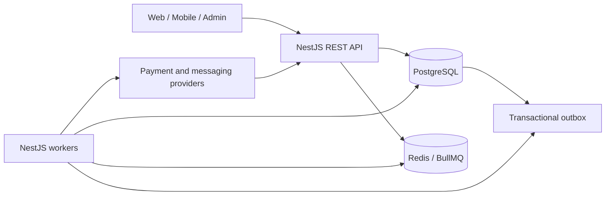

# System Architecture

## Decision

Aeshbuy begins as a modular NestJS monolith with separate API and worker processes. Modules own domain behavior and expose explicit injected contracts. PostgreSQL is the transactional source of truth. Redis supports queues/cache/coordination but never owns financial balances or reward schedules.

## Runtime boundaries

- `src/main.ts`: public HTTP API only.
- `src/worker.ts`: background application context without a public listener.
- `src/modules`: domain/application boundaries.
- `src/database`: Prisma persistence.
- `src/infrastructure`: Redis, queues and future provider adapters.
- `src/common`: cross-cutting transport concerns without domain rules.

## Reliability rules

Critical state and its outbox event are committed in one database transaction. Workers claim authoritative database records, use stable idempotency keys, tolerate redelivery, apply bounded exponential retry, and record terminal failures. External calls never occur inside a financial database transaction.

## Deployment

The same immutable image runs as API or worker with different commands. Managed PostgreSQL/Redis are preferred outside local development. Schema migrations execute as a distinct release step before application rollout. Health endpoints distinguish process liveness from database readiness.
