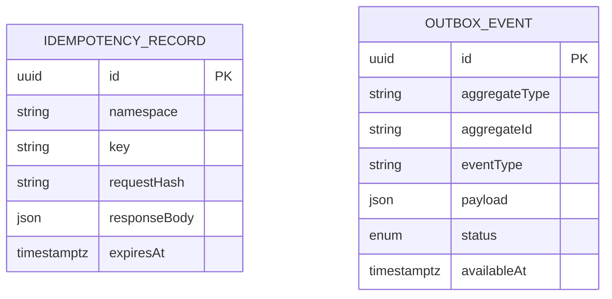

# Database Design

## Conventions

- PostgreSQL with Prisma migrations; UUID primary keys and `timestamptz` audit timestamps.
- Money uses `NUMERIC`/Prisma `Decimal` with currency and documented rounding; never `float` or JavaScript `number` arithmetic.
- Foreign keys, unique constraints, checks and query-aligned composite indexes enforce invariants close to the data.
- Posted ledger entries and audit history are append-only; correction uses linked reversals.
- Status values are explicit enums and transitions are validated in domain services.

## Foundation schema

Sprint 1 introduces `OutboxEvent` and `IdempotencyRecord`. The outbox persists reliable downstream work. The idempotency table uniquely scopes a client/provider key to a request hash and stored outcome.

Future bounded contexts and entity groups are enumerated in the master specification. They will be added in their owning sprint rather than as unused speculative tables. Each financial migration requires PostgreSQL integration/invariant tests and an upgrade/recovery plan.
